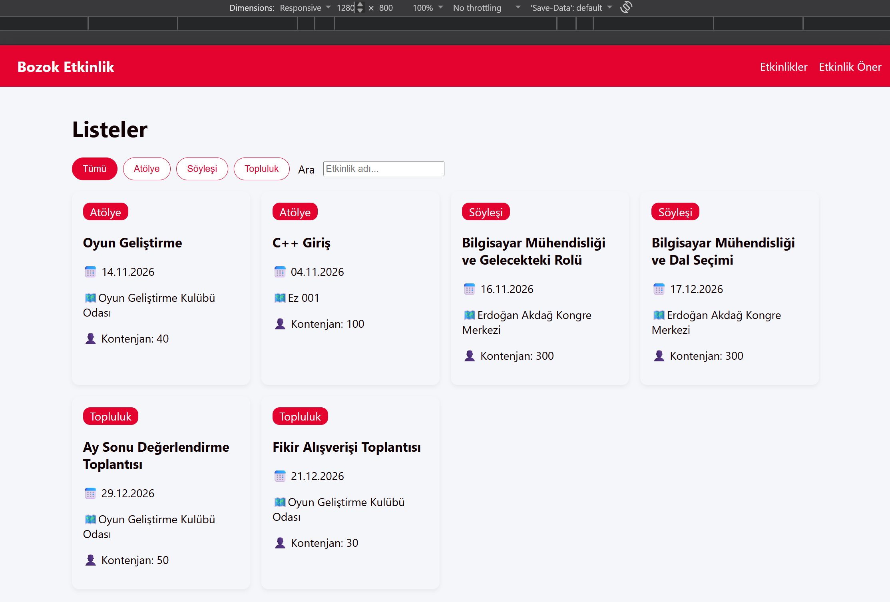

# Kampüs Etkinlik Panosu

## Amaç
...

## Kurulum
```bash
git clone https://github.com/1GaKi1/bmh231-odev2.git
cd bmh231-odev2
npm start
```
Tarayıcıda `http://localhost:3000` adresini açın.

## API
| Yöntem | Yol | Durum |
|---|---|---|
| GET | `/api/etkinlikler` | 200 |
| GET | `/api/etkinlikler?tur=atolye` | 200 |
| GET | `/api/etkinlikler/3` | 200 |
| GET | `/api/etkinlikler/999` | 404 |
| GET dışı | herhangi | 405 |

## Ekran Görüntüsü
